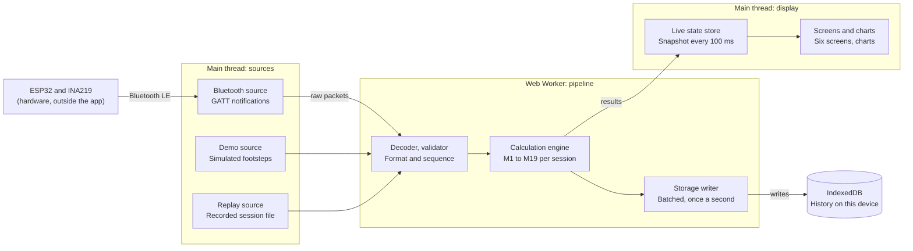
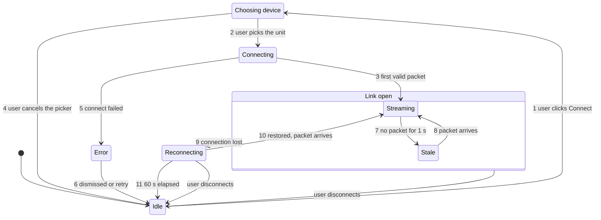

# F.O.R.C.E Dashboard — System Architecture Document

Nov 15, 2026 · Florix Energy

The F.O.R.C.E Dashboard is a browser app in which one background worker turns raw Bluetooth packets from the ESP32 into every number it shows and stores. This document gives its components, data flow, calculation rules, failure handling and the decisions still open.

## 1. Purpose and scope

This document defines how the F.O.R.C.E Dashboard is built: its components, the path of data from the ESP32 over Bluetooth to the charts, and the rules that keep the numbers correct. It covers software only. The hardware is a fixed data source: one tile with six modules, one INA219 sensor reading the DC output directly after the bridge rectifier, and one ESP32.

It implements the Product Requirements Document (PRD): requirements FR-1 to FR-19 and metrics M1 to M19. Where the two differ, the PRD says what the product does and this document says how.

| In scope | Out of scope |
| --- | --- |
| Bluetooth connection and packet decoding in the browser | ESP32 firmware design (only the interface it must expose, section 6) |
| Calculations: power, energy, steps, ESG, score | Circuit, sensor and tile mechanics |
| Local storage, charts, screens, export | Server, accounts and cloud sync in v1 (outlined in section 17) |
| Testing, deployment, evolution to several tiles | Native iPhone app |

Readers: the developers who build the app and the founder who signs off the design choices listed in section 18.

## 2. Architectural drivers

Seven constraints decide most of the design. Each one forces a specific choice later in this document.

| Driver | Source | Consequence for the design |
| --- | --- | --- |
| One sensor reads the tile output after the bridge rectifier | Your clarification, PRD section 5 | The app receives only voltage and current. Power, energy, steps and ESG figures are all derived in the app. There is no battery or load data. |
| Bluetooth Low Energy is the only link | Your clarification | The browser talks to the unit through Web Bluetooth. No gateway or serial port; packets stay within 20 bytes. |
| Step counting needs at least 20 samples per second | PRD section 5 | The device streams at 20 Hz or more; the pipeline must keep up and detect lost packets. |
| Calculations live in the app | Your clarification | One deterministic calculation module, tested offline against recorded files. |
| The app must run with no hardware | PRD NFR (testability) | The data source is an interface with three implementations: Bluetooth, demo, replay. |
| Web Bluetooth is Chromium-only and needs HTTPS and a user click | General browser behaviour | A web app served over HTTPS, a Connect button, and an "unsupported browser" path to demo mode. |
| More tiles will follow | PRD phase 3 | Every record carries a device ID from day one, so a second tile adds data and screens, not a redesign. |

**Quality attributes, in priority order:**

1. **Correctness.** Energy from a recorded file matches a hand calculation to within 0.1% (PRD).
2. **Data integrity.** Lost packets show as gaps and are never filled with invented values.
3. **Responsiveness.** New data is on screen within 1 second; charts stay smooth for at least 1 hour at 20 to 50 samples per second.
4. **Testability.** The whole app runs against a simulator with no hardware.
5. **Changeability.** Thresholds, units and formulas sit in one profile per device.

## 3. Architecture overview and principles

The dashboard is a single-page web app with one direction of data flow. A packet arrives from the ESP32, is decoded and checked, passes through a calculation pipeline, and the results go two ways at once: into the local database and onto the live screens. Nothing flows back to the device in v1.

The app has five layers, each depending only on the one before it:

1. **Data sources:** Bluetooth, demo generator, file replay. All produce the same stream of raw samples.
2. **Ingest:** decodes bytes into samples and rejects bad packets.
3. **Pipeline:** calculates every metric from valid samples (runs in a background worker).
4. **State and storage:** live values in memory, history in the browser's local database.
5. **Screens:** charts, tiles and tables that only read state.

**Design rules.** Every later section follows these.

| Rule | What it means in practice |
| --- | --- |
| Raw in, derived in the app | The device sends voltage, current and time. Every other number is calculated here, so formulas can be corrected without touching firmware. |
| Integer maths at the edge | Millivolts, milliamps and milliseconds stay integers through power and energy accumulation, so totals do not drift with rounding. |
| Never invent data | A gap longer than 1 second is skipped in integration and drawn as a gap. No interpolation across it. |
| One stream, many sources | The pipeline cannot tell whether samples came from the unit, the demo generator or a replayed file. |
| Raw log is append-only | Stored samples are never edited. Derived values can always be recomputed from them. |
| Screens never calculate | Components display values from state. All formulas live in the calculation module. |
| Settings are data | Thresholds, emission factor, sensor limit and units live in a device profile, not in code. |

## 4. Component architecture

The app has nine parts. Three sources on the main thread feed raw packets to one worker; the worker decodes, calculates and writes; the main thread only displays what the worker sends back. IndexedDB is the one durable store.



Read left to right: a packet enters through any one of the sources, is checked and turned into numbers in the worker, and leaves as live values for the screens and as records for the database. Screens ask the worker for history instead of reading the database directly.

| Component | Runs on | Responsibility |
| --- | --- | --- |
| Bluetooth source | Main thread | Device picker, connect, Device Info, notifications, reconnect (section 6) |
| Demo source | Main thread | Simulated footsteps from the packet simulator; always labelled Demo |
| Replay source | Main thread | Plays a recorded session file at its original timing; always labelled Replay |
| Decoder, validator | Worker | Bytes to samples; drops malformed, duplicate and late packets; opens gap records (section 7) |
| Calculation engine | Worker | Every metric M1 to M19 (section 8) |
| Storage writer | Worker | Batched writes, history queries, export and import (section 9) |
| Live state store | Main thread | Latest values, new chart points, alerts and connection state |
| Screens and charts | Main thread | The six screens; display only, no calculation (section 10) |
| IndexedDB | Browser | Durable history on the user's device |

## 5. Technology stack

The stack is a browser-only toolchain with no server. Like the PRD's technical approach, these are recommendations for the build team; the one hard constraint is Web Bluetooth.

| Layer | Recommendation | Why | Alternative considered |
| --- | --- | --- | --- |
| Language | TypeScript, strict mode | Packet layouts and metric units are checked by the compiler | Plain JavaScript: no type safety on byte offsets |
| App framework | React with Vite | Fast to build, large ecosystem, static output | Svelte or Vue: equally able, smaller hiring pool |
| Installable app | Progressive web app (service worker + manifest) | Works offline after first load; installs on desktop and Android | Plain website: no offline start |
| Bluetooth | Web Bluetooth API behind one connection module | No app install, no gateway; BLE only | Native wrapper (Capacitor): only if iPhone becomes a requirement |
| Calculation host | Dedicated Web Worker | Keeps parsing and integration off the UI thread | Main thread: charts stutter when storage writes stall |
| Live state | A small store (for example Zustand) | Few moving parts; screens subscribe to slices | Redux: more ceremony than a one-way stream needs |
| Local database | IndexedDB through Dexie or idb | Holds hours of samples; survives refresh and restart | SQLite in the browser (OPFS): consider if queries outgrow IndexedDB |
| Time-series charts | Canvas library such as uPlot | Smooth at 20 to 50 samples per second over 1 hour | SVG charts: slow beyond a few thousand points |
| Bars, rings, tiles | A standard chart library or plain SVG | Few points, styling matters more than speed | Reuse the canvas library: awkward for rings |
| Tests | Vitest, Playwright, packet simulator | Unit tests for formulas; browser tests against the simulator | Manual testing only: cannot prove the 0.1% energy target |
| Hosting | Any static HTTPS host | HTTPS is required for Web Bluetooth | Own server: adds operations with no v1 benefit |

## 6. Device interface layer

One module, the Bluetooth source, owns everything that touches the browser's Bluetooth API. It turns a GATT notification into a validated raw sample and tells the rest of the app only three things: a sample arrived, the connection state changed, or an error occurred.

**Connection steps.**

1. The user clicks Connect (the browser requires this).
2. The module requests a device filtered by the name prefix `FORCE-` and the F.O.R.C.E service. The browser shows its own device picker.
3. It connects, reads Device Info once (device ID, firmware version, sample rate, sensor current limit) and stores it in the device profile.
4. It starts notifications on the Telemetry characteristic and forwards every packet to the decoder.

The service and characteristic UUIDs are not in the project files. They are agreed with the ESP32 side in Phase 0 and kept in one constants file.

**Packet layout** (the proposed contract from PRD section 5, little-endian, 15 bytes, inside the default 20-byte payload):

| Offset | Size | Field | Type | Unit |
| --- | --- | --- | --- | --- |
| 0 | 2 | Sequence number | unsigned | none |
| 2 | 4 | Device time | unsigned | ms since ESP32 start |
| 6 | 2 | Voltage | unsigned | mV |
| 8 | 2 | Current | signed | mA |
| 10 | 4 | Power (optional) | unsigned | mW |
| 14 | 1 | Status flags | bit field | sensor fault, current at limit |

**Decoder.** It reads the packet with a `DataView`, rejects any packet shorter than 15 bytes and ignores extra bytes so a longer future packet still parses. It emits a raw sample: device ID, sequence, device time, millivolts, milliamps, optional milliwatts, flags and the arrival time. Arrival time is used only to place a session on the clock; integration always uses device time. The 4-byte device time wraps after about 49.7 days, so differences are taken as unsigned subtraction.

**Reconnect.** When the link drops, the module retries with a short back-off (1 s, then 2 s, 4 s, capped at 5 s) for 60 seconds, reusing the device the user already chose. After a page reload the browser may require the picker again, depending on its support for remembered devices. Each drop and recovery is logged as a connection event, so gaps can be explained on screen.

**Throughput.** At 20 samples per second the stream is 300 bytes per second; at 50 it is 750. This is far below what a BLE link carries, so the limit is the ESP32's sampling loop, not the radio.

**Signal strength (M17).** Web Bluetooth reports RSSI only from advertisement events, not on an open connection. The app shows RSSI when the browser provides it and "not available" otherwise. This comes from general browser behaviour, not the project files.

**Other browsers.** Where `navigator.bluetooth` is missing (Safari, Firefox, iOS browsers) the module reports "unsupported" and the app offers demo mode.

**Other layouts.** Decoders are chosen by a protocol field in the device profile. If the ESP32 already sends data in a different format, that is a new decoder behind the same interface, not a change to the pipeline.

## 7. Data model and telemetry pipeline

Eight record types carry all the app's data. Every one carries a device ID, so a second tile in phase 3 needs no schema change.

| Record | Holds | Written |
| --- | --- | --- |
| Device | ID, name, firmware version, sample rate, sensor current limit, profile ID | On connect |
| Profile | Idle and step thresholds, minimum step gap, emission factor, LED watts, phone battery Wh, kcal per step, score weights | When settings change |
| Session | Start time, end time, recorded time, bridged time, excluded gap time, energy, peak power, steps | Opened on connect, updated every second, closed on disconnect or stop |
| Raw sample | Session ID, sequence, device time, mV, mA, optional mW, flags, arrival time | Every valid packet, in batches |
| Gap | Session ID, start and end device time, cause (lost packets, link down, device restart) | When detected |
| Step event | Session ID, device time, peak power, pulse duration, pulse energy | On each step |
| Minute bucket | Session ID, minute, energy, average and peak power, steps, sample count, gap time | Each minute |
| Connection event | Time, type (connected, dropped, reconnected, error), detail | On each change |

Raw samples are the source of truth. Step events, buckets and session totals can all be recomputed from them, which is how a corrected step threshold is applied to an old session.

**Pipeline stages.** A packet takes six steps from radio to pixel:

1. **Receive** (main thread). Web Bluetooth is not available inside workers, so the connection module runs on the main thread. It copies the 15 bytes, stamps the arrival time and transfers the buffer to the worker without parsing it.
2. **Decode and validate** (worker). Length check, field ranges, device time moving forward. A packet that fails is counted and dropped; the calculation never sees it.
3. **Sequence check.** The expected sequence number is the previous plus one, modulo 65,536. A larger step records missing packets and opens a gap record.
4. **Calculate.** Per-session reducers update power, generation state, energy, peak, average, the step detector, cadence and the sensor-limit flag (section 8).
5. **Persist and publish.** The raw sample and step events join a write batch, flushed about once per second. A snapshot of live values and the new chart points go to the main thread about every 100 ms.
6. **Render.** Screens read the snapshot; charts append points to their canvas.

Batching at 100 ms keeps the screen within the PRD's 1-second limit while sending the UI ten messages per second instead of twenty to fifty.

## 8. Calculation engine

The engine is a set of pure functions plus one small state record per device session. Each valid sample updates the state in constant time, so cost does not grow with session length. It has no access to screens, storage or Bluetooth, which is what makes it testable against recorded files.

**Energy.** Power is the product of the two integers the sensor reports: millivolts times milliamps gives microwatts exactly. Between each sample and the one before it, energy is the average of their two power values times the time between them, using device time stamps:

```latex
E = \sum_{i} \frac{P_{i-1} + P_{i}}{2}\,(t_i - t_{i-1}) \qquad \text{only where } t_i - t_{i-1} \le 1000\ \text{ms}
```

Microwatts times milliseconds is nanojoules, so every interval is an integer (the sum is kept doubled to avoid halves). Per-minute accumulators stay far below the 2^53 safe-integer limit; they are folded into the session total in microjoules. The PRD states energy as power times the time between samples; the averaged form is the same rule applied to both ends of the interval, and the hand-calculation test (0.1%) uses it.

**Metric by metric.**

| Metrics | Calculation | State kept |
| --- | --- | --- |
| M1, M2, M3 | Voltage and current as received. Power is the device's value if sent, else voltage times current. If both are present and differ by more than 1%, the sample is flagged. | Last sample |
| M4 | Generating when power exceeds the idle threshold (set) for a short hold time (set, proposed default 1 s), otherwise idle. The hold stops the label flickering between steps. | Current state, hold timer |
| M5, M6 | M5 is the energy sum above for the open session. M6 adds M5 across closed sessions, read from stored session records. | Session energy accumulators |
| M7 | Session energy divided by recorded time, where recorded time excludes gaps over 1 second. | Recorded milliseconds |
| M8 | Highest power seen in the session. | One number |
| M9, M11 | Step detector (below). | Detector state, 1-second sample buffer |
| M10 | Steps with a time stamp in the last 10 seconds, times 6. Shown as unavailable until 10 recorded seconds exist after a gap. | Ring of step times |
| M12 | Step events grouped by clock hour. The clock comes from the session's arrival-time anchor plus device time. | Per-hour counters |
| M13 | Energy in kWh times the grid emission factor (set). | None; derived from M6 |
| M14 | Energy in Wh divided by the reference LED watts (set) and by the phone battery Wh (set). | None |
| M15 | Step count; calories only if kcal per step (set) is filled in. | None |
| M16 | Weighted mix of M13, M14 and M15, each scaled 0 to 100 against a target. Weights and targets are open (section 18); the function reads them from the profile. | None |
| M17 | RSSI when the browser provides it (section 6). | Last value |
| M18 | Packets arrived in the last second; missing sequence numbers counted with their total duration. | Counters |
| M19 | Current at or above the sensor limit from Device Info (overridable), or the device's limit flag. | Flag |

**Step detector.** A hysteresis state machine on power:

1. **Waiting.** Power is below half the step threshold.
2. **In pulse.** Power has risen above half the threshold. The pulse start is the first sample above it. If power also passes the full step threshold, the pulse is marked valid.
3. **Counted.** When power falls back below half the threshold and the pulse was valid, one step is emitted with the pulse's peak power, duration and energy (the energy sum over the pulse window).
4. **Minimum gap.** A pulse starting closer than the minimum gap (set) after the previous step is merged into it instead of counted again.

The detector looks only at samples already received, so a step appears when its pulse ends, typically 100 to 200 ms after the heel strike. The Calibration screen replays the same detector over live data with the thresholds drawn, which is how defaults are tuned.

**Numeric rules.**

- Integers for everything from the packet to the energy sum; floating point only for display values and ESG conversions.
- Intervals over 1 second are excluded from energy and from recorded time, and shown as gaps.
- Intervals up to 1 second that span lost packets are integrated between the two real samples that bound them and counted as bridged time, which the screen shows next to the total (section 12).
- Reprocessing a stored session with changed thresholds gives the same result as live processing with those thresholds.

## 9. Storage and persistence

All history lives in the browser's IndexedDB database on the user's device. The worker is the only writer; screens read through query functions. Raw samples are stored packed in one-second chunks rather than one record each, which cuts record count by 20 to 50 times and keeps writes cheap.

| Store | Key | Contents | Growth |
| --- | --- | --- | --- |
| devices | Device ID | Device record and last Device Info | One per tile |
| profiles | Profile ID | Settings profile (section 7) | One per device |
| sessions | Session ID | Session totals and status | A few per day |
| sample chunks | Session ID + start time | About one second of raw samples as a packed binary buffer (15 bytes per sample) | 1 chunk per second |
| gaps | Session ID + start time | Gap records with cause | Only on loss |
| steps | Session ID + device time | Step events | One per step |
| minute buckets | Session ID + minute | Energy, average and peak power, steps, gap time | 1,440 per day |
| events | Time | Connection events | Few per session |

**Writes.** The worker queues samples and flushes one transaction per second. A flush writes the open sample chunk, new step and gap records, the minute bucket in progress and the session record. If the page closes mid-session, at most about one second is lost. On the next start any session without an end time is marked "interrupted" and closed at its last stored sample.

**Reads.** Live charts take points from the pipeline, not the database. History views choose by zoom: ranges beyond 1 hour read minute buckets; ranges of 1 hour or less read sample chunks and reduce them to a minimum and maximum per pixel column, so peaks are never smoothed away.

**Retention and quota.** Sessions, step events and minute buckets are small and kept until the user deletes them. Raw sample chunks are the bulk, so retention is a setting. A proposed default is 30 days of raw data, after which only the chunks are removed and the session keeps its totals, steps and buckets; the app offers CSV export first. The app requests persistent storage so the browser does not evict the database, checks the storage estimate, and warns at 80% use (proposed threshold).

**Export and import.**

- **CSV** of raw samples (device time, clock time, mV, mA, mW, flags) and of session summaries, as the PRD requires.
- **JSON backup** of a whole session with its profile, which the replay source can read back in. This is how a field recording becomes a regression test (section 15).

**Schema changes.** The database is versioned, and each version ships a migration, so an update to the app never strands stored sessions.

## 10. Application and UI architecture

The app is split into modules that mirror the layers in section 3. The worker and the screens never import each other; they talk through a typed message protocol, which keeps the calculation code runnable in plain tests.

| Module | Runs on | Responsibility |
| --- | --- | --- |
| sources | Main thread | Bluetooth, demo and replay sources behind one interface; sends raw packets to the worker |
| worker | Web Worker | Decoder, validator, calculation engine, storage writer, history queries |
| state | Main thread | Live snapshot store; screens subscribe to slices such as "headline tiles" or "connection" |
| screens | Main thread | The six screens from PRD section 8 |
| charts | Main thread | Live time-series chart, bar and ring charts, step markers, gap shading |
| settings | Both | Device profile editor; changes go to the worker and are saved |
| export | Worker | CSV and JSON export and import |

**Messages.** Main to worker: raw packet, source state, start and stop session, profile change, history query. Worker to main: live snapshot, new chart points, step event, alert, session closed, query result. Packet buffers are transferred, not copied.

**Screens and their data.** Every value on a screen comes from exactly one place: the live snapshot or the database.

| Screen | Live data | Stored data | Redraw rate |
| --- | --- | --- | --- |
| Overview | Headline tiles: power, session and total energy, steps, score | Total energy, steps per hour | Tiles 4 per second; charts 1 per second |
| Live | Power chart with step markers and gaps, voltage and current | Recent window from the live buffer | Chart up to 10 per second |
| Sessions | None | Session list, per-session charts, comparison | On open |
| Calibration | Live power with thresholds drawn | None | Chart up to 10 per second |
| Connection | State, signal strength, sample rate, gaps, Device Info | Connection events | 1 per second |
| Settings | None | Device profile | On change |

**Charts.** The live chart keeps a ring buffer of typed arrays in memory for the chosen window (30 seconds, 5 minutes or 1 hour; 1 hour at 20 Hz is 72,000 points). New points are appended and the canvas is redrawn at most 10 times a second. Step markers and gap shading are drawn from step and gap records, so what the user sees is what is stored.

**Demo and replay.** A banner reads "Demo" or "Replay" whenever the source is not the unit, and these sessions are labelled in the session list so they can never be mistaken for real generation.

**Offline and updates.** The service worker caches the app so it starts without internet (Bluetooth needs none). A new version waits behind a "reload to update" prompt and never reloads during an open session.

**Keeping the tab alive.** Browsers may slow a hidden tab. The app asks the Screen Wake Lock API to keep the display on during a session where available, and warns when the tab is hidden while streaming.

## 11. Connection lifecycle

The Bluetooth source is a seven-state machine, and the session follows it: a session opens at the first packet (transition 3) and closes on transition 11 or when the user disconnects. Where the browser has no Bluetooth API the app never leaves Idle and Connect is disabled.



Numbers on the arrows match the table. Streaming and Stale sit together because the link is open in both; only the data differs.

| # | Transition | Trigger | What the app does |
| --- | --- | --- | --- |
| 1 | Idle to Choosing device | User clicks Connect | Opens the browser's device picker, filtered to `FORCE-` units |
| 2 | Choosing device to Connecting | User picks the unit | Connects to GATT, reads Device Info, starts notifications |
| 3 | Connecting to Streaming | First valid packet arrives | Opens a session, loads the device profile, shows live values |
| 4 | Choosing device to Idle | User cancels the picker | Nothing changes and no error is shown |
| 5 | Connecting to Error | Unit not found, service missing or permission denied | Shows a plain-language message that names the cause |
| 6 | Error to Idle | User dismisses the message or tries again | Clears the message |
| 7 | Streaming to Stale | No packet for over 1 second | Opens a gap, dims live values, keeps the session open |
| 8 | Stale to Streaming | A packet arrives | Closes the gap and checks sequence and device time; a device-time reset starts a new session |
| 9 | Link open to Reconnecting | Browser reports the connection lost | Opens a gap with cause "link down" and starts retries with back-off |
| 10 | Reconnecting to Streaming | Connection restored and a packet arrives | Closes the gap and continues the same session |
| 11 | Reconnecting to Idle | 60 seconds without success, or the user disconnects | Closes the session; stored data is kept; Connect is offered again |

## 12. Error handling and data quality

Every failure the app can detect is counted, stored with the session and shown to the user. None is silently repaired. The rule behind all of it: a number on screen is either measured or labelled as not measured.

| Condition | How it is detected | Handling | What the user sees |
| --- | --- | --- | --- |
| Lost packets | Sequence number jumps by more than 1 | Gap record. Up to 1 second: integrated between the bounding real samples and counted as bridged time. Over 1 second: excluded from energy and recorded time. | Gap shading on charts; lost-packet count on Connection |
| Link down | Browser disconnect event | State becomes reconnecting; gap record with cause "link down"; automatic retry for 60 seconds | "Reconnecting" banner with a countdown |
| Stale stream | Link open but no packet for over 1 second | Gap opens at the last sample; state becomes stale | "No data" on tiles; values dimmed |
| Device restart | Device time moves backwards | Current session closed; new session opened; gap cause "device restart" | Notice naming both sessions |
| Duplicate or late packet | Sequence number not above the last one | Dropped and counted | Count on Connection |
| Malformed packet | Shorter than 15 bytes or fields out of range | Dropped and counted; never reaches the calculation | Decoder error count on Connection |
| Sensor limit reached | Current at or above the limit, or the device flag | Samples marked clipped; energy still counted but flagged as possibly under-reported | M19 alert; marker on the chart |
| Negative power | Voltage times current below zero | Stored as received; treated as zero in energy and step logic | Count in the session's data-quality line |
| Low sample rate | Measured rate below 20 per second | Step counting continues but is marked unreliable | Warning on Connection and Calibration |
| Clock drift | Device-time elapsed differs from arrival-time elapsed by over 1% across a minute without gaps (proposed threshold) | Logged; arrival time is never used for integration | Note in the session's data-quality line |
| Storage full or write error | Failed transaction or quota warning | Streaming continues in memory; writes retry; export of unsaved data offered | Persistent banner |
| Unsupported browser | No Bluetooth API | Connect disabled; demo mode offered | "Use Chrome or Edge" message |

**Data-quality line.** Each session shows recorded time, bridged time, excluded gap time, lost packets and dropped packets beside its energy total. This is the PRD's rule that recorded energy and recorded time appear together, made concrete.

**Failure isolation.** A fault in the worker or a decoder exception ends only the current session, with the cause logged and shown; stored history stays intact because the worker never rewrites records. The app restarts the worker and waits for the user to reconnect.

## 13. Security and privacy

Version 1 has a small attack surface because it has no server, no account and no personal data: the only inputs are the user's clicks, Bluetooth packets from a chosen device, and files the user imports.

| Area | Design |
| --- | --- |
| Transport to the page | Served over HTTPS only; Web Bluetooth requires it. |
| Device access | The browser's device picker, shown after a user click, is the consent step. The app cannot scan or connect silently. |
| Link security | The proposed contract has no pairing or encryption. The data is low-sensitivity electrical telemetry, but anyone in range with a BLE client could read it. Bonding on the ESP32 is listed as an open question (section 18). |
| Packets as untrusted input | The decoder bounds-checks every field and drops what does not fit; bytes are never evaluated or used as markup. |
| Imported files | JSON and CSV imports are validated against a schema and a size limit before use; a replay file can only supply samples. |
| Data at rest | Stays in the browser's database on the user's device. Nothing is sent anywhere in v1. A "delete all data" action is in Settings. Data is not encrypted, so a shared kiosk should use its own browser profile. |
| Third-party code | No analytics, advertising or tracking scripts. Libraries are self-hosted and pinned by lockfile, with dependency audits in the build. |
| Content security policy | Scripts, styles, fonts and connections limited to the app's own origin; no inline scripts. |
| Honest provenance | Every session and export records its source (unit, demo or replay), firmware version, app version and the thresholds used, so ESG figures shown to a client can be traced to a real recording. |

**Cloud sync later (phase 3).** Adds sign-in, encrypted transport and per-organisation separation, and uploads derived data by default rather than every raw sample. The design for it is in section 17; nothing in v1 assumes it.

## 14. Performance and capacity budget

One tile produces very little data: even at 50 samples per second the stream is 750 bytes per second. The budgets below are design targets to be measured in Phase 1, not measurements.

**Data volume** (raw samples packed at 15 bytes, before database record overhead):

| Sample rate | Samples per hour | Raw data per hour | Raw data per day, connected 24 hours | Chunk records per hour |
| --- | --- | --- | --- | --- |
| 20 Hz | 72,000 | 1.08 MB | 25.9 MB | 3,600 |
| 50 Hz | 180,000 | 2.70 MB | 64.8 MB | 3,600 |

The PRD's performance target is 20 to 50 samples per second for at least 1 hour, up to 180,000 samples, which is the second row. Connected around the clock at 50 Hz, 30 days of raw data is about 1.9 GB, so the quota warning from section 9 and the retention setting matter more than any code optimisation. Minute buckets add 1,440 small records per day regardless of rate.

**Time and memory budgets.**

| Stage | Budget | Reason |
| --- | --- | --- |
| Packet to worker | Under 10 ms | One 15-byte transfer, no parsing on the main thread |
| Decode and calculate | Under 0.1 ms per sample (about 0.5% of one core at 50 Hz) | Constant-time reducers, no allocation per sample |
| Batch to screen | 100 ms | Publish interval from section 7 |
| Chart draw | Under 16 ms per frame, at most 10 frames per second | Canvas library fed typed arrays; reduce to pixel columns if a frame runs over |
| Packet to pixel, total | Under 1 second | PRD requirement; the stages above use about 0.25 s |
| Live buffer memory | About 6 MB for 1 hour at 50 Hz | Four 64-bit channels (time, power, voltage, current) times 180,000 points |
| Database writes | One transaction per second | A chunk, a few records, the session update |

**What would break the budget.** Drawing every point as an SVG element, parsing on the main thread, or writing one database record per sample. The design avoids all three.

**Verification.** The Phase 1 gate (a 60-minute run on the real unit) records worker time per sample, frame time, dropped frames and write latency, using the packet simulator at 50 Hz as the worst case.

## 15. Testing strategy

The architecture makes most of the app testable without hardware: the calculation engine is pure, and every data source produces the same stream. Tests are layered from cheap to expensive.

| Level | What it proves | How | Runs |
| --- | --- | --- | --- |
| Unit | Decoder reads each field and rejects malformed packets; energy, step detector, cadence and ESG formulas are correct; sequence wrap and device-time wrap work | Vitest with hand-built packets and tables of expected values | Every commit |
| Golden files | Energy from a recorded session matches a hand calculation within 0.1%; reprocessing a stored session gives identical totals | Recorded JSON sessions checked into the repo with expected results | Every commit |
| Fault injection | Lost packets, duplicates, reordering, a 5-second dropout, a device restart and a stale stream give the gap and session behaviour in section 12 | Packet simulator with scripted faults | Every commit |
| Browser end to end | Connect, stream, disconnect, reconnect, export and reload flows work, and screens show the right values | Playwright driving the app against the demo and replay sources, with a fake Bluetooth device in test builds | Every commit |
| Performance | The budgets in section 14 hold at 50 Hz for 1 hour | Simulator run with timing counters | Before each release |
| Hardware in the loop | The parser and timing work with the real ESP32 and a tile | Manual 60-minute run on the unit; Phase 1 gate | Before each release |
| Step accuracy | Detected steps match a manual count within the agreed tolerance | A person walks a set number of steps while the Calibration screen records; the tolerance is set with you | Each time thresholds change |

**Packet simulator.** One module that produces the same 15-byte packets as the ESP32: footstep pulses at a chosen cadence and amplitude, noise, a chosen sample rate, and scripted faults. It feeds the demo source in the app, the end-to-end tests and the Phase 0 gate, so the app, the tests and the demo can never drift apart.

**Recordings become tests.** Any real session can be exported as a JSON backup (section 9) and added as a golden file. A bug seen in the field is reproduced by replaying its recording.

**Not testable without hardware.** The real radio behaviour: actual packet loss, connection interval, and how the ESP32 behaves under reconnect. These are covered only by the hardware runs above.

## 16. Deployment and release

The app ships as a folder of static files on any HTTPS host. With no server there is nothing to operate beyond the host itself.

**Build and delivery.** Each change runs type checks, lint, unit, golden-file and fault-injection tests, the browser tests, and a production build. Every pull request gets its own preview address over HTTPS, which is enough to test on a real tile with a laptop or an Android phone. Local development also works because browsers treat localhost as a secure context.

**Environments.** Preview (per change), staging (release candidates, used for the hardware run) and production. The three differ only by address and a visible environment label.

**Versions.** The app has a version number shown in Settings and written into every session and export. The database schema has its own version. The service worker cache is versioned with the app, and old caches are removed on update.

**Rollback.** Rolling back is redeploying the previous build. To keep that safe, schema migrations only add fields and stores, and the app tolerates a database one version newer than it expects. A migration that cannot be made additive needs an explicit decision before release.

**Support without telemetry.** Because v1 sends nothing to a server, a problem report relies on a "diagnostic file" the user can export from Settings: versions, device info, connection events and the data-quality lines of recent sessions, with no raw samples.

**Release phases.** These match the PRD's four phases and gates.

| Phase | Architecture delivered | Gate |
| --- | --- | --- |
| 0. Foundations | Data contract agreed with the ESP32 side; packet simulator; source interface, Bluetooth module and decoder; app skeleton with Connect screen | Simulator and the real unit both stream packets the decoder reads with no errors |
| 1. Core dashboard | Worker pipeline, calculation engine for M3 to M12, live chart and tiles, IndexedDB storage, sessions, Calibration, automatic reconnect, CSV export | PRD success metrics met on the real unit in a 60-minute run |
| 2. Client-ready | Profile editor, Connection screen, alerts, ESG panel and score, session comparison, fullscreen mode, demo mode | Shown to one client or pilot site without engineer help |
| 3. Multi-tile | Device registry and several simultaneous sources, floor-plan heatmap, optional cloud sync (section 17) | A second tile with its own sensor and ESP32 available for testing |

## 17. Evolution to Phase 3

Phase 3 adds several tiles, each with its own sensor and ESP32, a floor-plan heatmap and optional cloud sync. The v1 design was shaped so that this is mostly additions: the engine, decoder and storage format stay, and every record already carries a device ID.

| Area | Version 1 | Phase 3 | What changes |
| --- | --- | --- | --- |
| Sources | One Bluetooth source | One source per tile, or a gateway | Several Bluetooth connections, each chosen by the user in the browser's picker; the number that works at once depends on the computer's adapter and must be tested. For a large floor, a gateway that collects from many tiles and forwards over the network becomes a new source type behind the same interface. |
| Pipeline | One session state | One state per device | The worker already keeps state per session; it runs one reducer chain for each device. |
| Storage | Records keyed by device ID | Same | A site-level view reads minute buckets from all devices; no schema change. |
| Screens | One tile | Tile picker, site totals, heatmap | Overview sums energy and steps across tiles; the heatmap colours each tile's position on a floor plan by steps per hour or energy from its minute buckets. |
| Settings | One profile per device | Profiles per device plus site settings | Emission factor and score weights move to site level; thresholds stay per device. |
| Sharing | Local only | Optional sync | See below. |

**Floor plan.** A tile registry stores each device's name and position on an uploaded floor image or a grid. The heatmap is a pure view over data the app already holds. The PRD defers it because one tile has one sensor and nothing to compare.

**Cloud sync.** Optional, off by default, and added behind a storage interface so screens do not change.

- **What goes up:** sessions, minute buckets, step events, connection events and profiles. Raw samples stay local unless the user opts in.
- **How:** a hosted database with sign-in and encrypted transport; each site belongs to one organisation.
- **Conflicts:** records are immutable and carry a unique ID built from device, session and time, so uploads are safe to repeat and merge. Only profile settings can conflict; the newest saved version wins and the older one is kept in history.
- **Offline:** changes queue locally and upload when a connection returns, matching the app's offline-first behaviour.

**Not decided.** Whether a gateway is needed depends on how many tiles are planned for one site and how far they are from the screen; both are open questions in section 18.

## 18. Decisions, risks and open questions

Ten decisions shape this design. Three come from you or the PRD, and the other seven are proposals that need your sign-off or the hardware owner's input.

**Decisions.**

| ID | Decision | Reason | Status |
| --- | --- | --- | --- |
| D1 | Data arrives over Bluetooth Low Energy through Web Bluetooth, with no gateway in v1 | Your requirement | Given |
| D2 | All calculations happen in the app; the device sends raw voltage, current and time | yes happens in this web application  | Given |
| D3 | Bluetooth runs on the main thread; decoding and calculation run in a worker | Web Bluetooth is not available in workers; keeps charts smooth | Proposed |
| D4 | Energy uses the average of two neighbouring samples times device-time difference; intervals over 1 second are excluded | Accurate for short pulses; matches the PRD's gap rule | Proposed; PRD wording to be aligned |
| D5 | Raw samples stored packed in one-second chunks | 20 to 50 times fewer records than one per sample | Proposed |
| D6 | Raw data kept 30 days by default, with a quota warning at 80% | Bounds storage; session totals survive | Proposed |
| D7 | A device restart closes the session and opens a new one | Device time restarts, so one integration cannot continue across it | Proposed |
| D8 | Negative power is stored but counted as zero in energy and step logic | A rectified output should not be negative; small negatives are sensor offset | Proposed |
| D9 | One data-source interface with Bluetooth, demo and replay implementations | Testing without hardware; later gateway or several tiles | Proposed |
| D10 | No server, account or telemetry in v1 | PRD scope | Given |

**Risks.**

| Risk | Effect | Mitigation |
| --- | --- | --- |
| The ESP32 sends a different format or a lower rate than the proposed contract | Parser rework; steps missed | One decoder per protocol; Phase 0 gate; warning below 20 samples per second |
| Web Bluetooth is Chromium-only and needs HTTPS | iPhone and Safari users cannot connect | Unsupported-browser screen, demo mode, wrapped app as a later option |
| A hidden tab is slowed by the browser | Delayed display, irregular arrival times | Integration uses device time; Wake Lock; hidden-tab warning |
| Step detection miscounts | Wrong step count and energy per step | Calibration screen; stored raw data can be reprocessed with new thresholds |
| Browser evicts or fills local storage | History lost | Persistent-storage request, quota warning, CSV and JSON export |
| Rollback meets a newer database schema | App cannot open stored data | Additive migrations; tolerate one newer version |
| Unencrypted Bluetooth link | Anyone in range could read telemetry | Ask for bonding on the ESP32; data is low-sensitivity |
| Current above the sensor limit | Readings stop rising and under-report | Clipped-sample flag and the M19 alert |

**Open questions for the hardware owner and for you.**

1. Does the ESP32 already send BLE data? If so, in what format and at what rate? The service and characteristic UUIDs are needed in Phase 0. yes it has been coded in the esp machine to send such information 
2. Can Device Info include a protocol version, and Telemetry a boot counter? Both make format changes and restarts unambiguous. noo using the pulse we count it 
3. Should the ESP32 require bonding before it streams?
4. What is the real current limit with six modules? The files rate the INA219 at dont know 
5. How is the sustainability score calculated, which grid emission factor applies, and what counts as wellness impact?
6. Do you accept D4 to D8, in particular the 30-day raw retention and the restart rule?
7. Is iPhone or iPad support required?
8. How many tiles will one site have, and how far from the screen? That decides whether a gateway is needed.
